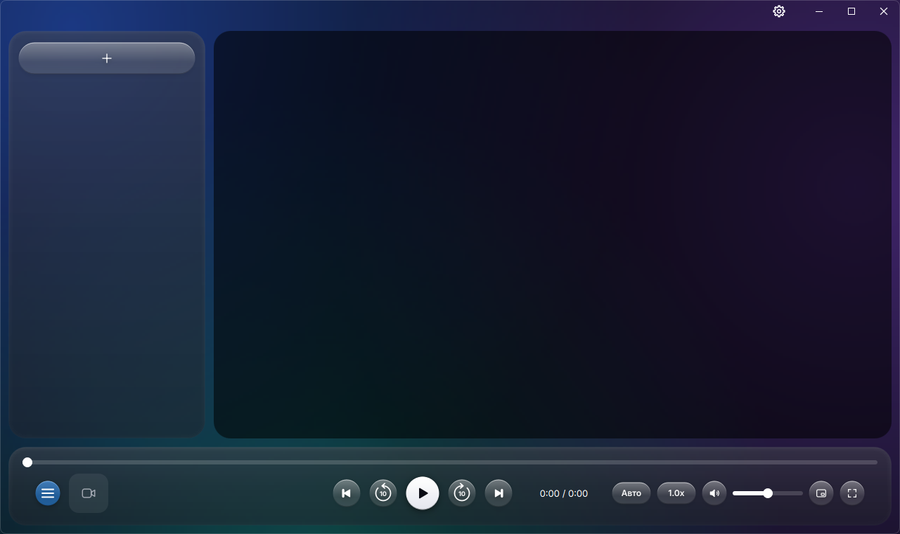
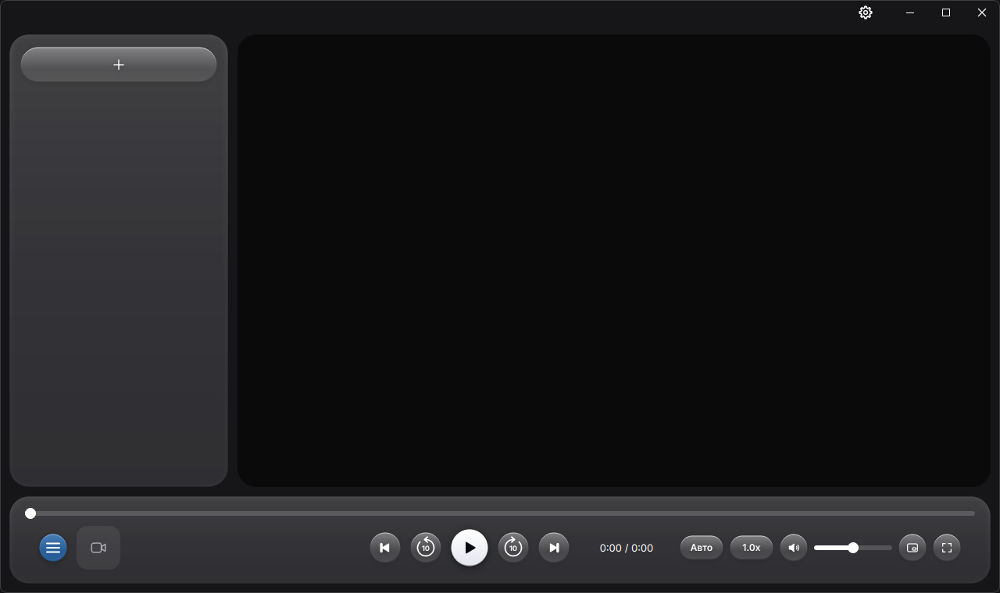
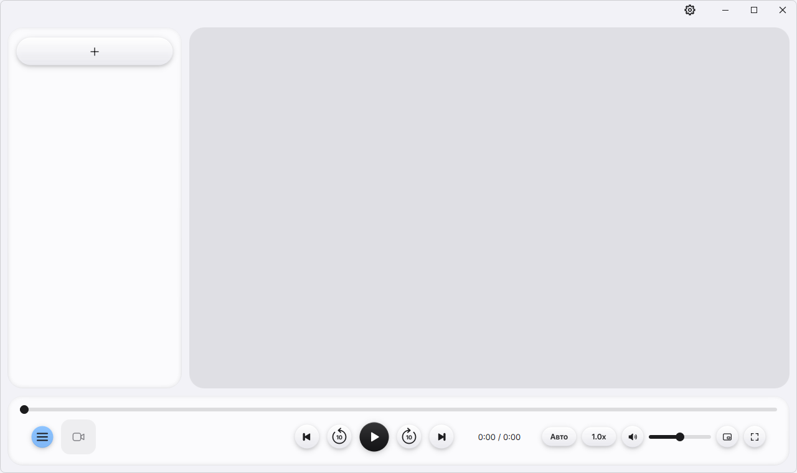

  

<h1 align="center">Lucent</h1>

  Видеоплеер для Windows в стиле Liquid Glass

  
  
  

  <a href="https://github.com/bartholomewgm/Lucent/releases/latest"><b>⬇ Скачать установщик</b></a>

  

> Ранний доступ. Положил для себя

## Возможности

- **Три темы** — «Градиент», «Тёмная», «Светлая». В «Градиенте» фон окна перекрашивается под цвета видео, в остальных вокруг картинки мягкий цветной ореол
- **Почти любые форматы** — MP4, MKV, AVI, MOV, WMV, WebM, FLV, MPEG, VOB, TS/M2TS, 3GP, OGV, RM/RMVB и другие
- **Мини-плеер** — маленькое окно поверх остальных, размер меняется за края, вокруг — свечение цветов видео
- **Папка-плейлист** — все видео из папки и подпапок сразу в очереди, новые файлы добавляются сами
- **Продолжение с места остановки** — всегда, никогда или с вопросом
- **Свойства видео** — разрешение, частота кадров, кодеки, битрейт, звук
- **Формат картинки и скорость** — Авто, 16:9, 4:3, 21:9, растянуть; скорость от 0.5x до 2x
- **Удобно с клавиатуры** — горячие клавиши почти на всё
- **Русский, українська, English** — язык меняется на лету

<table>
  <tr>
    <td></td>
    <td></td>
  </tr>
  <tr>
    <td align="center">Тёмная</td>
    <td align="center">Светлая</td>
  </tr>
</table>

## Установка

Скачайте **Lucent-Setup.exe** из [последнего релиза](https://github.com/bartholomewgm/Lucent/releases/latest) и запустите. Права администратора не нужны. Lucent появится в меню «Пуск» и в списке «Открыть с помощью» для видеофайлов; новая версия ставится поверх старой, настройки и история сохраняются.

Windows может показать «Система Windows защитила ваш компьютер» — приложение не подписано. Нажмите «Подробнее» → «Выполнить в любом случае».

## Как пользоваться

Видео добавляется кнопкой «+» на боковой панели или перетаскиванием в окно. Двойной клик по видео — полный экран. Настройки — шестерёнка ⚙ в правом верхнем углу.

Правый клик по видео в очереди: «Свойства» и «Удалить из очереди» (файл на диске остаётся). «Свойства» открывает и клик по обложке или названию внизу.

<b>Кнопки панели управления</b>

 

Слева направо:

| Кнопка | Действие |
|:------:|----------|
| ☰ | Показать / скрыть плейлист |
| ⏮ | Предыдущее видео |
| ↺ 10 | Назад 10 сек |
| ▶ / ⏸ | Play / Pause |
| ↻ 10 | Вперёд 10 сек |
| ⏭ | Следующее видео |
| `Авто` | Формат картинки: Авто, 16:9, 4:3, 21:9, Растянуть |
| `1.0x` | Скорость воспроизведения |
| 🔊 | Выкл / вкл звук |
| ⧉ | Мини-плеер |
| ⤢ | Полный экран |

<b>Горячие клавиши</b>

 

| Клавиша | Действие |
|:-------:|----------|
| `Пробел` / `K` | Play / Pause |
| `→` / `L` | Вперёд 5 сек |
| `←` / `J` | Назад 5 сек |
| `Ctrl + →` | Вперёд 30 сек |
| `Ctrl + ←` | Назад 30 сек |
| `↑` / `↓` | Громкость + / − |
| `M` | Выкл / вкл звук |
| `F` / `F11` | Полный экран |
| `Esc` | Выйти из полного экрана |
| `N` / `P` | Следующее / предыдущее видео |
| `[` / `]` | Скорость − / + |
| `Backspace` | Сброс скорости (1x) |
| `Home` / `End` | В начало / в конец |
| `A` | Следующий формат картинки |
| `Ctrl + M` | Мини-плеер |
| `Ctrl + L` | Показать / скрыть плейлист |
| `Ctrl + O` | Открыть файл |
| `Ctrl + I` | Свойства видео |
| `Ctrl + ,` | Настройки |
| `Delete` | Удалить выделенное видео из очереди |
| `F5` | Перезагрузить видео |
| `Ctrl + Q` | Выход |

